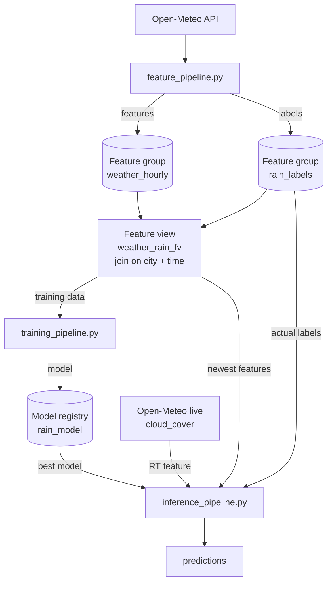

# Rain in Zurich: FTI pipelines with Hopsworks
MLOps Projektarbeit, CAS AI Operations (FHNW). Predicts whether it will rain in Zurich in the next 2 hours, built as
three separate pipelines (feature, training, inference) around the Hopsworks feature store and model registry.

## Setup and run
**Requirements:** [Docker](https://www.docker.com/) with Docker Compose, and a free account on
[hopsworks.ai](https://www.hopsworks.ai/) with a project and an API key. Everything runs in your own project: the
pipelines create the feature group, feature view and model there, so start with the backfill and the training.

```bash
cp .env.example .env                                         # then set HOPSWORKS_API_KEY and HOPSWORKS_PROJECT
docker compose run --rm web feature_pipeline.py --backfill   # once: ~2 years of history into the feature store
docker compose run --rm web training_pipeline.py             # train, evaluate, register the model
docker compose up --build -d                                 # start the two services below
```
Then open http://localhost:8000. `docker compose logs -f` follows both services, `docker compose down` stops them.

| Service | What it does |
|---|---|
| `features` | Runs `feature_pipeline.py` immediately at start, then at minute 1 of every hour. Open-Meteo delivers hourly values and the pipeline keeps rows up to the current time, so a new hour is available right after the full hour; running more often would only rewrite the same hours. |
| `web` | `serve.py`: logs in and loads the best model once, then every page load or click on "Refresh prediction" runs a fresh inference (live `cloud_cover` + newest features) and returns the predictions page. |

Training stays a manual step. The web app keeps the model it loaded at start, so restart it
(`docker compose restart web`) after training a better one.
`docker compose run --rm web <script>` runs any script once, for example
`docker compose run --rm web inference_pipeline.py` writes the predictions page as a static file to `output/predictions.html`.

**Dependencies:** Python 3.12.14 (Hopsworks needs Python < 3.14), packages pinned in `requirements.txt`, both installed
into the image by the `Dockerfile`. `hopsworks[python]` is needed instead of plain `hopsworks`, which lacks pyarrow
for reading and writing features. The image is built for `linux/amd64`, because `hops-deltalake` (required by
`hopsworks[python]`) has no Linux ARM wheel; on Apple Silicon Docker Desktop runs it under emulation, which works but is slower.

## Assessment overview
| Assessment criterion | Where to find it |
|---|---|
| FTI architecture, feature store used for the features | [Architecture](#architecture-fti) |
| Pipeline steps complete, aggregated and RT feature used at inference | [Pipelines](#pipelines), [Features](#features) |
| Data and model described, dependencies, run instructions | [Data](#data), [Setup and run](#setup-and-run), [Model](#model) |
| Limitations and difficulties | [Limitations and difficulties](#limitations-and-difficulties), [Reflection](#reflection-from-batch-scripts-to-a-production-like-setup) |

## Architecture (FTI)
No pipeline starts another one or passes data to it directly. They only exchange data through the Hopsworks
feature store and the Hopsworks model registry, so each one can run on its own schedule.



| Hopsworks object | Details |
|---|---|
| Feature group `weather_hourly` (v2) | Features only. Primary key `city` + `time`, event time `time`, offline store. Written by the feature pipeline (insert = upsert on the primary key). |
| Feature group `rain_labels` (v1) | Label `rain_next_2h` only, for the hours whose label is already known. Same primary key and event time. Written by the feature pipeline. |
| Feature view `weather_rain_fv` (v2) | Query: all features of `weather_hourly` except `city` and `time`, left joined with `rain_labels` on `city` + `time`, label `rain_next_2h`. Used for training data and for loading the newest features at inference. |
| Model registry, model `rain_model` | Each training run registers a new version with its metrics. Inference loads the version with the best F1. |

Features and labels are kept in separate feature groups, as in real systems where labels often come from another
source and arrive later than the features (here 2 hours later). The join key is the primary key `city` + `time`, so
every feature row gets exactly the label of its own hour. A point-in-time join on `city` alone would give the newest
hours, which have no label yet, the label of an older hour. The join is a left join, so these newest hours stay in the
feature view and inference can use them.

### Why the decoupling matters
- **Own schedule for each pipeline:** the feature pipeline runs hourly (as often as the data changes), training runs
  rarely and by hand, inference runs whenever a prediction is requested. None of them has to wait for or start another.
- **Features are computed once:** the aggregated features are engineered only in the feature pipeline. Training and
  inference both read them from the same feature view, so the inference does not reimplement the feature engineering,
  a common cause of training-serving skew (course slide decks 15 and 20). Only the RT feature is fetched at inference.
- **Failures stay local:** inference uses stored features only while they belong to the current UTC hour. If a
  feature update is delayed or fails, the web app keeps showing the last page with a loading banner instead of
  presenting old data as current. If a training run fails, the best registered model keeps serving.
- **Each pipeline can be changed or replaced on its own:** a different model, a streaming feature pipeline or another
  compute engine would not require changes in the other pipelines, as long as the names of the Hopsworks objects stay
  the same.

The code follows the same rule: no pipeline imports another one. The only shared file is
[`pipeline_config.py`](pipeline_config.py), which holds no logic, just the contract between the pipelines: the
location (stored features and the live RT feature must come from the same place) and the names and versions of the
feature groups, feature view and model.

## Pipelines
| Pipeline | Input | Steps | Output |
|---|---|---|---|
| `feature_pipeline.py` | Raw hourly weather data (Open-Meteo) | 1. Fetch raw data via API<br>2. Engineer rolling window features<br>3. Build one dataframe with features and label<br>4. Get or create the two feature groups (primary key + event time)<br>5. Insert the features into `weather_hourly` and the known labels into `rain_labels` | Features in `weather_hourly`, labels in `rain_labels` |
| `training_pipeline.py` | Features and labels from the feature store | 1. Load both feature groups<br>2. Get or create the feature view (left join on `city` + `time`, label)<br>3. Create the training dataset from the feature view (time based train/test split)<br>4. Train and evaluate<br>5. Save locally with `joblib.dump`, upload with `create_model` + `model.save` | New model version in the registry |
| `inference_pipeline.py` | Newest features, live data, model | 1. Fetch live `cloud_cover` (RT feature)<br>2. Get the feature view and load the newest features<br>3. Download the best model from the registry<br>4. Predict | Prediction for the next 2 hours (plus the last 7 days for comparison) |

`serve.py` is a small web app around the same inference code (`connect()` once at start, `predict()` per page load).
All timestamps are stored in UTC.

Inference requires features from the current UTC hour before applying live `cloud_cover`. If those features are
missing or outdated, the web app shows its last page (or an empty page right after start) with a loading banner
and reloads it every 15 seconds until the features are there; CLI inference stops without generating a new page.
This can happen briefly at the start of an hour while the scheduled feature update finishes.
Previously exported HTML files are static snapshots and do not refresh automatically.

## Features
| Feature | Type | Computed where | Used at inference |
|---|---|---|---|
| `humidity_mean_24h` | Aggregated (rolling 24h mean of relative humidity) | Feature pipeline, stored in the feature group | Loaded from the feature view |
| `pressure_change_3h` | Aggregated (pressure difference over 3 hours) | Feature pipeline, stored in the feature group | Loaded from the feature view |
| `cloud_cover` | RT feature | Fetched live from the Open-Meteo `current` endpoint at the moment of the prediction | Replaces the stored value of the newest hour |
| `temperature_2m`, `relative_humidity_2m`, `pressure_msl`, `precipitation` | Raw hourly values | Feature pipeline | Loaded from the feature view |

The historical `cloud_cover` values are stored in the feature group so the model can be trained on them;
at inference only the live value is used for the current hour.

**Label:** `rain_next_2h` = 1 if at least 0.1 mm precipitation falls in the 2 hours after the hour.
Labels are stored in their own feature group `rain_labels`, only for hours whose label is known. The newest 2 hours
therefore have features but no label yet (the future is not known yet). The left join in the feature view keeps them,
so inference always sees features up to the current hour. A later feature pipeline run adds their label.

## Data
[Open-Meteo](https://open-meteo.com/) hourly weather for Zurich (47.37, 8.55), no API key needed.
The data splits naturally into historical data for training and current data for inference:
- **Historical:** archive API (ERA5 reanalysis), 2024-01-01 until about 6 days ago, loaded once with `--backfill`
- **Current:** forecast API, last 7 days up to the current hour, loaded by every regular feature pipeline run
- **Live (RT):** forecast API `current=cloud_cover`, fetched by the inference at prediction time

## Limitations and difficulties
- **Two data sources for one feature set:** the backfill uses the reanalysis archive (ERA5), recent hours come from the
  forecast API's past data. Both are model data, not station measurements, and can differ slightly
  (possible training-serving skew).
- **RT feature at inference:** `cloud_cover` is replaced by the current value from the forecast API. In training
  the same column comes from the hourly data, so the two values are close but not produced identically.
- **Simple scheduling:** the hourly feature run is a sleep loop in a container, so it only runs while Docker runs
  on this machine. In production a scheduler would trigger it (cron, GitHub Actions, Airflow or a Hopsworks job).
  Training is still started by hand.
- **Online inference from the offline store:** the web app predicts on request (online prediction), but reads the
  features from the offline feature group. A request took about 3.6 s in my test (Apple Silicon, amd64 emulation).
  For low latency the feature group would be `online_enabled` so the newest features come from the online store.
- **Model choice:** inference uses the registered version with the best F1 (`get_best_model`). Hopsworks has
  no alias mechanism like MLflow's `champion` in the course.
- **One location only** (Zurich); predictions only go to the HTML page, they are not written back to the feature store,
  so there is no prediction history or monitoring beyond the last 7 days. A third feature group with location data
  (elevation, coordinates) joined on `city` would only help with several locations, for one city it is constant.
- **Difficulties:**
  - `pip install hopsworks` alone is not enough, the `[python]` extra is needed (pyarrow).
  - Login fails with "Could not find any project" until a project exists in the Hopsworks UI. Without a project
    name the client only picks the project automatically if the account has exactly one; with several it asks
    interactively, which fails in the background services. That is why `HOPSWORKS_PROJECT` is set in `.env`
    (the Hopsworks client reads it from the environment).
  - `get_batch_data(event_time=True)` returns one event time per joined feature group, each under a prefixed column
    name (`<project>_<feature group>_<version>_time`). The inference script keeps the one of `weather_hourly` as
    `time` and drops the one of `rain_labels`, otherwise it would end up as an extra model input.
  - Docker build on Apple Silicon failed at first: `hops-deltalake` only has wheels for macOS ARM and Linux x86_64,
    so the image is pinned to `linux/amd64`.

## Known issues
The following issue was reproduced in a local code review with synthetic data and remains unresolved:

- **Missing hours can distort features and labels:** `fetch()` drops rows with missing values, while `engineer()`
  calculates rolling windows and shifts by row count. If an hour is missing, the two-hour label can include rain
  three hours ahead, and the humidity and pressure windows can span longer than intended. Hourly continuity is
  not validated before these calculations.

Resolved from the same review: stale or empty feature windows now produce an explicit loading state,
as described under [Pipelines](#pipelines), instead of a misleading current forecast or an `IndexError`.

## Reflection: from batch scripts to a production-like setup
**What I noticed.** After building the predictions page I saw that it only showed the current hour after running
both scripts again: first the feature pipeline, then the inference pipeline. My first idea was to always run them
together. Looking at it more closely, that would turn the three pipelines back into one chained process, which is
what the FTI architecture tries to avoid (course slide deck 15: pipelines connected only through the feature store and
the model registry, each one optimizable and scalable on its own).

**What I changed because of it.** The pipelines now run on their own rhythm and only meet in the feature store:
- The feature pipeline runs as often as the data changes. Open-Meteo delivers hourly values, so it runs at minute 1 of
  every hour, right after a new hour becomes available. Running it every few minutes would only rewrite the same rows.
- The inference runs when someone needs a prediction (page load or "Refresh prediction") and simply uses the newest
  features that are in the feature store at that moment, plus the live `cloud_cover` as RT feature.
- Training runs rarely and by hand; the web app picks the best registered model at start.

In the terms of the course (slide deck 11) this moved the project from offline (batch) prediction to online prediction
with batch features plus one RT feature.

**What a faster use case would need.** I asked myself what would happen with data that changes every second, like a
ticker. Re-running scripts every second would not work: in my setup one inference request already takes several
seconds (reading the newest features from the offline store). Such a system would need a different architecture:
a streaming feature pipeline that keeps running and computes NRT features, the online store of the feature store for
fast lookups, and a model that stays loaded in a serving process. Hourly weather data does not need this, so I kept
the batch feature pipeline.

**What I would do next.**
- Enable the online store for the feature group, so online inference does not read from the offline store.
- Run the feature pipeline with a real scheduler (GitHub Actions or a Hopsworks job) instead of a loop on my machine.
- Write predictions back to the feature store. The labels arrive 2 hours later (natural labels), so a separate
  monitoring pipeline could then track the hit rate over time instead of only the last 7 days shown on the page.

---

*The following sections are not part of the assessment (model performance and extensions are not graded) and are kept
for completeness.*

## Model
`GradientBoostingClassifier(n_estimators=10)` from scikit-learn, evaluated with accuracy, precision, recall and F1
(same setup as the course exercises).

The train/test split is by time (train 2024-01-01 to 2025-12-31, test from 2026-01-01) instead of a random split:
neighbouring hours are almost identical, so a random split would leak information into the test set.
Inference loads the registered version with the best F1 (`get_best_model`), the Hopsworks counterpart to the MLflow
`champion` alias used in the course.

## Results (run on 2026-11-15, with the two feature groups)
- Backfill: 25,033 hourly rows (2024-01-01 to 2026-11-09), rain share 25.8%
- Training: 17,521 train rows, 7,643 test rows; accuracy 0.89, precision 0.83, recall 0.63, F1 0.72 (`rain_model` v4)
- Inference: features up to the current hour, live `cloud_cover` 16%, prediction "no rain in the next 2 hours"
- Predictions page (last 7 days): 128 of 166 hours correct (77%), 43 of 70 rainy hours caught, 11 false alarms

## Predictions page
Light and dark mode. The current 2 hour forecast with rain probability on top, then hit rate, caught rain hours and
false alarms, a timeline of the model's rain probability against the hours where rain actually fell, and an hour by
hour grid where a cross marks every wrong prediction. The newest hour uses the live `cloud_cover`; older hours use the
stored features. The last 2 hours show as "not known yet" until a later feature pipeline run adds their label.
Times on the page are shown in Europe/Zurich.

## Extensions implemented
From the list of possible extensions in the assignment:
- **Train/test split in the Hopsworks training dataset** (`fv.train_test_split`) instead of scikit-learn's `train_test_split()`
- **Inference in a web application** (`serve.py`) in addition to the inference pipeline
- **Containerization** (`Dockerfile`, `docker-compose.yml`)
- **Several feature groups joined by key:** features in `weather_hourly`, labels in `rain_labels`, joined in the
  feature view on `city` + `time` (see [Architecture](#architecture-fti))
